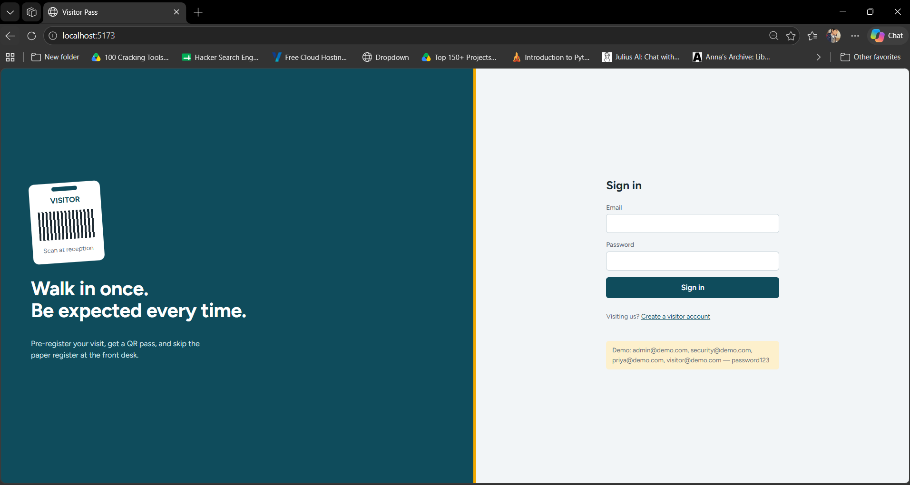
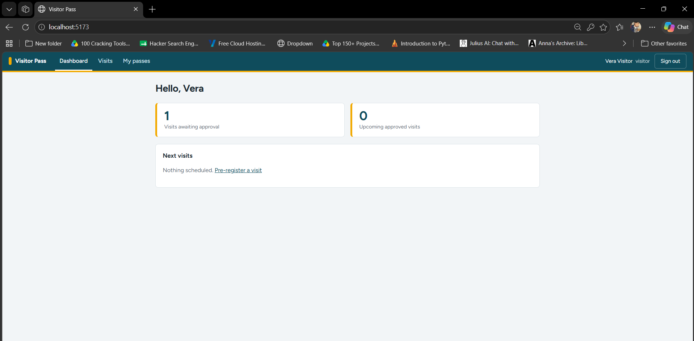
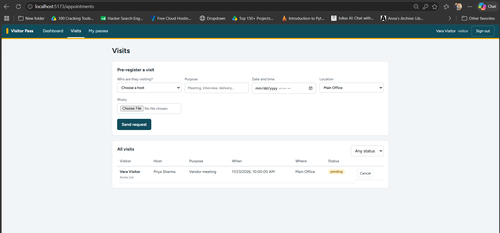
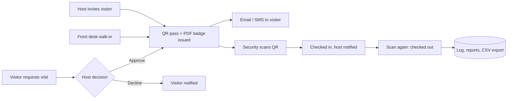

<div align="center">

# Visitor Pass Management System

**Replace the paper visitor register with pre-registration, QR passes, and a live check-in log.**


[Live demo](#live-demo) · [Demo video](#live-demo) · [Features](#features) · [Quick start](#quick-start) · [API](#api-reference)

</div>

---

## About

Many offices, campuses, and facilities still log visitors in a paper register. It is slow, hard to search, and gives nobody a reliable answer to the question *"who is in the building right now?"*

This project digitises the whole visit, from invitation to exit:

1. A visitor pre-registers (or a host invites them, or the front desk registers a walk-in).
2. The host approves the visit and a **QR pass with a printable PDF badge** is issued automatically.
3. Security **scans the QR** at the door. The first scan checks the visitor in, the next one checks them out.
4. Everyone involved is notified by **email and SMS**, and every event lands in a searchable, exportable log.

Built as a full MERN-stack project with JWT authentication, four role-based experiences, and an audit trail.

## Live demo

| | |
|---|---|
| Application | **Add your Vercel link here** |
| API health check | **Add your Render link here**`/api/health` |
| Demo video | **Add your video link here** |

> The free backend sleeps when idle, so the first request can take 30 to 50 seconds.

## Screenshots

<table>
  <tr>
    <td width="50%" align="center"><b>Sign in</b><br><br></td>
    <td width="50%" align="center"><b>Visitor dashboard</b><br><br></td>
  </tr>
  <tr>
    <td colspan="2" align="center"><b>Pre-register a visit and track its status</b><br><br></td>
  </tr>
</table>

<!--
More screenshots: add pass.png, scan.png, dashboard.png and reports.png to the
screenshots folder, then remove the comment markers around this block.

<table>
  <tr>
    <td width="50%" align="center"><b>Visitor pass with QR</b><br><br></td>
    <td width="50%" align="center"><b>QR scanner</b><br><br></td>
  </tr>
  <tr>
    <td width="50%" align="center"><b>Admin dashboard</b><br><br></td>
    <td width="50%" align="center"><b>Reports</b><br><br></td>
  </tr>
</table>
-->

## Features

| Area | What it does |
|---|---|
| **Authentication** | JWT sign-in, bcrypt-hashed passwords, role-based route protection on both API and UI |
| **Visitor registration** | Self sign-up for visitors with details and photo upload |
| **Pre-registration** | Visitors request a visit, choose a host and location, and wait for approval |
| **Invites and walk-ins** | Hosts invite visitors; the front desk registers walk-ins with an instant pass |
| **Approval workflow** | Hosts approve or decline; visitors can cancel; every change notifies the other side |
| **Pass issuance** | Unique QR code per visit, valid for the visit day, plus a downloadable **PDF badge** with photo |
| **Check-in / check-out** | Scan with the device camera or type the code. Revoked, cancelled, or out-of-date passes are rejected |
| **Notifications** | Email through SMTP (Nodemailer) and SMS through Twilio. Falls back to console logs when not configured |
| **Dashboard** | People inside now, check-ins today, pending approvals, 7-day trend, busiest hosts |
| **Reports** | Search by name, email, or company; filter by event and date range; **CSV export** |
| **Admin tools** | Create and disable staff accounts, revoke passes, view the **audit log** |
| **Multi-location** | Each visit is tied to a location (main office, annex, warehouse) |
| **Deployment** | Docker Compose with Nginx for one-command setup |

## User roles

| Role | Can do |
|---|---|
| **Admin** | Everything: manage staff, view analytics and the audit log, revoke passes |
| **Security / front desk** | Register walk-ins, scan visitors in and out, view reports |
| **Employee (host)** | Invite visitors, approve or decline requests addressed to them |
| **Visitor** | Create an account, pre-register visits, view and download their pass |

## How it works



## Tech stack

| Layer | Technology |
|---|---|
| Frontend | React 18, React Router, Axios, Vite, html5-qrcode |
| Backend | Node.js, Express 5 |
| Database | MongoDB with Mongoose |
| Auth | JWT, bcryptjs |
| Passes | `qrcode` for QR images, `pdfkit` for PDF badges |
| Notifications | Nodemailer (email), Twilio (SMS) |
| Uploads | Multer |
| DevOps | Docker, Docker Compose, Nginx |

### Data model

`users` · `visitors` · `appointments` · `passes` · `checklogs` · `auditlogs`

## Quick start

**Requirements:** Node.js 18+ and MongoDB (local install or a free [Atlas](https://www.mongodb.com/atlas) cluster).

```bash
git clone https://github.com/hack2ai/visitor-pass-mern.git
cd visitor-pass-mern
```

**1. Start the API**

```bash
cd server
npm install
cp .env.example .env     # set MONGO_URI and JWT_SECRET
npm run seed             # loads demo users, visits, and history
npm run dev              # http://localhost:5000
```

**2. Start the web app** (in a second terminal)

```bash
cd client
npm install
npm run dev              # http://localhost:5173
```

### Run with Docker

```bash
docker compose up --build
docker compose exec server node src/seed.js
# open http://localhost:8080
```

### Environment variables

| Variable | Purpose |
|---|---|
| `MONGO_URI` | MongoDB connection string |
| `JWT_SECRET` | Secret used to sign tokens |
| `CLIENT_URL` | Frontend origin, used for CORS and links in messages |
| `SMTP_HOST`, `SMTP_PORT`, `SMTP_USER`, `SMTP_PASS`, `MAIL_FROM` | Optional email delivery |
| `TWILIO_SID`, `TWILIO_TOKEN`, `TWILIO_FROM` | Optional SMS delivery |
| `VITE_API_URL` | (client) Backend URL ending in `/api`, for deployed builds |

Without SMTP or Twilio settings, messages are printed in the server console so the full flow still works in development.

## Demo accounts

All demo accounts use the password `password123`.

| Role | Email |
|---|---|
| Admin | `admin@demo.com` |
| Security | `security@demo.com` |
| Host | `priya@demo.com` · `rahul@demo.com` |
| Visitor | `visitor@demo.com` |

### Try the full flow

1. Sign in as **visitor@demo.com**, open *Visits*, and pre-register a visit with Priya.
2. Sign in as **priya@demo.com** and approve it. A pass is issued and the visitor is notified.
3. Back as the visitor, open *My passes* to see the QR and download the PDF badge.
4. Sign in as **security@demo.com**, open *Scan*, and scan the QR (or paste the code printed by the seed script). First scan checks in, second checks out.
5. Open *Reports* to search, filter by date, and export CSV. As admin, open *Staff* for accounts and the audit log.

## API reference

<details>
<summary>Show endpoints</summary>

```
Auth
POST   /api/auth/register                 Visitor sign-up
POST   /api/auth/login
GET    /api/auth/me

Users
GET    /api/users/hosts                   Hosts a visitor can choose
GET    /api/users                         Admin: list accounts
POST   /api/users                         Admin: create staff
PATCH  /api/users/:id                     Admin: enable / disable

Appointments
POST   /api/appointments                  Visitor pre-registration (multipart, photo)
POST   /api/appointments/invite           Host invite / front-desk walk-in
GET    /api/appointments?status=          Scoped by role
PATCH  /api/appointments/:id/status       Host or admin: approve / reject
PATCH  /api/appointments/:id/cancel       Visitor cancels

Passes
GET    /api/passes/mine                   Visitor's passes
GET    /api/passes/:id                    Pass details
GET    /api/passes/:id/pdf                PDF badge
PATCH  /api/passes/:id/revoke             Admin / security

Check-in
POST   /api/checks/scan                   { code } toggles check-in / check-out

Reports
GET    /api/reports/summary               Dashboard numbers
GET    /api/reports/logs                  ?q=&type=&from=&to=
GET    /api/reports/export                CSV download
GET    /api/reports/audit                 Admin: audit log
```

</details>

## Project structure

```
visitor-pass-mern/
├── server/
│   └── src/
│       ├── index.js            App entry, routes, error handling
│       ├── seed.js             Demo data
│       ├── models/             Mongoose schemas
│       ├── middleware/         JWT auth, role guard, uploads
│       ├── routes/             auth, users, appointments, passes, checks, reports
│       └── utils/              notifications, pass issuing, PDF badge
├── client/
│   └── src/
│       ├── App.jsx             Layout and role-based routing
│       ├── AuthContext.jsx     Session state
│       ├── api.js              Axios instance and download helper
│       └── pages/              Login, Dashboard, Appointments, Pass, Scan, Reports, Users
├── docker-compose.yml
└── README.md
```

## Deployment

| Part | Platform | Settings |
|---|---|---|
| Database | MongoDB Atlas | Free M0 cluster, allow network access, copy connection string |
| Backend | Render / Railway | Root `server`, build `npm install`, start `npm start`, set `MONGO_URI`, `JWT_SECRET`, `CLIENT_URL` |
| Frontend | Vercel | Root `client`, preset Vite, set `VITE_API_URL=https://<backend>/api` |

After deploying, run `npm run seed` once against the production database. `CLIENT_URL` must match the frontend URL exactly (no trailing slash) or the browser will block requests.

> Free hosts use temporary disk storage, so uploaded photos can disappear on restart. For production, move uploads to S3 or Cloudinary.

## Security notes

- Passwords are hashed with bcrypt; sessions use signed JWTs that expire after 7 days.
- Every API route checks the user's role; hosts can only act on their own visits and visitors can only see their own passes.
- Passes are random 24-character codes, valid only on the visit day, and can be revoked.
- Uploads are limited to images under 3 MB.
- Secrets live in `.env`, which is excluded from Git.

## Roadmap

- [ ] OTP verification at visitor registration
- [ ] Multi-organization support
- [ ] Cloud image storage for photos
- [ ] Rate limiting and input validation hardening
- [ ] Automated tests

## Author

**Pankaj Kumar**
[GitHub](https://github.com/hack2ai) · [LinkedIn](https://www.linkedin.com/in/pankaj-kumar-ab591a216)

---

<div align="center">Built as a MERN-stack assignment project.</div>
